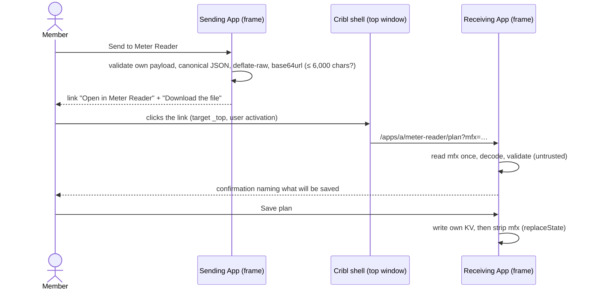

# Money Flow × Meter Reader: the integration contract

Status: **v1, the contract both Apps implement.** Written 2026-10-02; revised 2026-10-03 for the release pair Money Flow
0.16.1 and Meter Reader 1.2.0 (INT-P8's named exception, INT-DET1, INT-VAL4's years, INT-CALC9, INT-MR5, INT-MR8,
INT-MR10, INT-MF7, section 6.4, section 7, I-D23 to I-D29), then corrected the same day to say what shipped (INT-FLOWS,
INT-MR7, INT-VAL9, I-D7, I-D19, section 4.5's note, section 11; no rule changed), and revised again for the release pair
Money Flow 0.17.0 and Meter Reader 1.2.0 from the production review (`docs/review/2026-10-03-prod-review.md` PR-3, PR-4,
PR-7, PR-8, PR-20, PR-24, PR-25): like-for-like measurement (INT-CALC10, INT-CALC11, INT-PLAN `worth`, INT-DAILY `plans`,
INT-REP5, INT-MF10, INT-P8), the part day and the window's age (INT-CALC12, INT-CALC13), the file caps (INT-FILE4,
INT-FILE6), the link's length (INT-TX6), demo builds (INT-VER6), I-D30 to I-D36, then the same day for the install on the build org: no
`/apps` grant (INT-P7, INT-DET2, I-D37), and for Money Flow 0.17.1: `worth` is the worth the estimate used (INT-PLAN,
I-D38); section 12 lists every change. The same
file sits in both repositories
(Money Flow `docs/INTEGRATION.md`, Meter Reader `docs/INTEGRATION.md`); a change to one is made to both in the same
release pair. Files are cited as "Money Flow `app/core/meterReader.ts`" or "Meter Reader `core/rollups.ts`", never by a
relative link, so the text reads the same in either repository. Hosts and org ids are written `<host>` / `<org>`.

Every clause has a stable ID (`INT-…`). Tests in either repository cite the ID they cover.

> "I want these two apps deeply integrated with each other but not dependent on each other."
> "You don't need either app to do what you wanna do, but it adds additional enrichment insight if you had both of
> them to complement each other."
> "Money Flow will identify the opportunities based on what's in your system, while Meter Reader proves it by
> showing the receipt." (Steve)

In one paragraph: Money Flow plans which Cribl packs to roll out, when, and what each should save. Meter Reader
measures what every flow actually saves once it is live. An App cannot read another App's storage, so the plan and
the measurements move between them in a small versioned JSON document, carried either in a link the member clicks
(`?mfx=`) or in a file the member downloads and imports. The receiving App validates it, asks the member, and saves
it in its own storage. Each App works completely without the other.

---

## 1. Principles

| ID | Principle |
|---|---|
| INT-P1 | **Each App is complete alone.** No feature of either App requires the other. Nothing is disabled, greyed out or reduced when the other App is absent or cannot be detected. |
| INT-P2 | **Together they enrich.** Every integration feature is additive and appears only when the data behind it is in the App's own storage (a plan saved in Meter Reader, an import saved in Money Flow), or, for the "connected" line and the handoff link, when detection says the other App is present (INT-DET3). |
| INT-P3 | **No nags.** Each App carries exactly one quiet "better together" line, in one named place (Money Flow: its existing Report card prompt and pairing line, AC-5.1.1, D243, unchanged in count; Meter Reader: one line in Settings → Money Flow, INT-MR8). No toast, modal, banner, badge, nav dot, alert or email mentions the other App unprompted. |
| INT-P4 | **Data moves only by an explicit member action**: a click on a handoff link, or a file the member chooses. The receiving App writes only after a second explicit confirmation. No background sync, no polling of the other App, no automatic write. |
| INT-P5 | **Every payload is untrusted input.** It is validated in full (INT-VAL) before anything is shown, and the receiver stores only the fields it validated, re-serialised from its own types, never the raw text. |
| INT-P6 | **Each App writes only its own storage.** Neither writes, reads or calls the other's KV or backend (the platform refuses it anyway: "Your app cannot access other apps' resources", AGENTS.md "URL Rewriting Rules"). There is no shared key. |
| INT-P7 | **Read-only toward Cribl.** The integration adds no Cribl API grant: its one Cribl call, `GET /apps` (INT-DET1), cannot be declared (INT-DET2, I-D37). It adds no write to Cribl configuration, no proxy host and no backend dependency: everything runs in the member's browser, so it works on the Standard plan. Meter Reader's existing notification writes are unchanged; the Below plan alert (INT-MR3) uses them only when a member turned it on. |
| INT-P8 | **One arithmetic.** Where both Apps show the same quantity (a pack's measured savings, its status), both judge it with INT-CALC from the same days, so the two numbers match to the millicent. Those days are the pack's comparison days (INT-CALC1): the plan's own sources on the pack's pipeline (INT-CALC10), each saved GB valued as the plan valued it (INT-CALC11). Meter Reader computes them from its day rows and sends them in INT-DAILY `plans`; Money Flow judges a pack on exactly those (INT-MF10). **The fallback (I-D30, which supersedes I-D23's exception):** when Money Flow holds no such days for a pack (an export from before Meter Reader 1.2.0 sent them, a CSV, a plan Meter Reader holds another copy of, or a pack whose pipelines the member picked by hand), it adds up the pipelines mapped to the pack at Meter Reader's own prices, as before, and its Show the math says so and why. |
| INT-P9 | **Honest labels travel with the numbers.** Planned figures read "Planning estimate", measured ones "Measured", a reduction from Cribl's published range "Cribl's published figure (not yet measured)", a run-rate day "last hour × 24", whichever App shows them. |

## 2. Platform facts this contract rests on

| Fact | Status | Source |
|---|---|---|
| An App cannot read another App's KV or call its backend. KV is rewritten to the caller's own `/a/<appId>/kvstore/…`. | DOCUMENTED, MEASURED | AGENTS.md "URL Rewriting Rules"; Money Flow `SPIKE.md` (d), D32 |
| `GET /apps` ("List all Apps") answered 200, listing the installed Apps with their versions (admin credential, 2026-10-02). | MEASURED | Money Flow `SPIKE.md` (d) |
| `GET /apps` cannot be declared: the Leader refuses any Apps path (`/apps`, `/apps/...`) in `policies.yml` at the preinstall check and on install or upgrade. | MEASURED (2026-10-03) | Money Flow D644, `evidence/logs/upgrade-0.17.0-refused-apps-grant.json` |
| `GET /apps` from inside an App, as a member, with no grant. | **UNVERIFIED** | INT-LIVE4 |
| `GET /apps` is paginated: `{ items: AppInfo[], count, offset?, limit?, totalCount? }`; the spec's example shows `limit: 20`. `AppInfo` requires only `id`; `version` is the App's semver. | SPEC (bundled OpenAPI, Cribl 4.20.1) | `PaginatedAppInfo`, `AppInfo` |
| `GET /apps/<id>` answers 404 for an App that is not installed; Meter Reader's runner reads its own version with it. | MEASURED | Money Flow D253; Meter Reader README "Runtimes" |
| The App frame is `<iframe sandbox="allow-scripts allow-forms allow-popups allow-popups-to-escape-sandbox allow-downloads allow-top-navigation-by-user-activation" src="<host>/app-ui/<appId>/">`, with no `allow-same-origin`. | MEASURED | Money Flow `evidence/logs/live-frame-0.14.0.md` |
| A path deep link `/apps/a/<appId>/<path>` reaches the App's router (`/apps/a/money-flow/methodology` routed). | MEASURED | same evidence file |
| A query string (`?…`) or hash (`#…`) on `/apps/a/<appId>/<path>` reaches the App frame's `location`. | **UNVERIFIED** (the browser session expired before it was checked) | INT-LIVE1, INT-LIVE2 |
| To leave the frame, a link needs `target="_top"` or `target="_blank"`; top navigation is allowed only on a user activation (a real click). | DOCUMENTED + sandbox attribute | AGENTS.md "Linking Out of Your App" |
| `history.pushState` / `replaceState` in the App update the parent URL bar; parent navigation reaches the App as `popstate`. | DOCUMENTED; the replaceState strip is **UNVERIFIED** | AGENTS.md "Navigation"; INT-LIVE3 |
| Standard plan: no App backend compute, no App proxies. | MEASURED | Money Flow D18, D253; Meter Reader D23 |
| KV: about 100 KB per value (larger is chunked), 1,000 keys per App by default. | MEASURED | Money Flow `SPIKE.md` (a) |
| No web storage in the frame (opaque origin). | INFERRED from the sandbox | Money Flow D132 keeps none |

## 3. Detection

| ID | Rule |
|---|---|
| INT-DET1 | **The call.** `GET ${CRIBL_API_URL}/apps`, from the UI only, at most once per page load, on first need (a Settings render, or a page that would show a handoff link, a "connected" line or Money Flow's step-7 line, INT-MF7). Never from Meter Reader's sweep or Money Flow's snapshot, so it never spends their call budgets. Timeout 5 s. If `totalCount` says more Apps exist than were returned, read the next page with `?offset=` until the other App's id is found or the listing ends, at most 5 calls in all. |
| INT-DET2 | **No grant (I-D37).** Neither App declares `GET /apps` in `policies.yml`: the Leader refuses any Apps path there. Money Flow 0.17.0 declaring it was refused by `POST /apps/preinstall-check` and `PATCH /apps/<id>` with "policies.yml validation failed: policies/8/object: Apps management paths (/apps, /apps/...) are not allowed in object" (build org, 2026-10-03), so no package that declares it installs, and the narrower `GET /apps/<id>` is refused the same way. Each App makes INT-DET1's call without a grant; a refusal is `unknown` (INT-DET3), never an error (INT-DET4). Only `id` and `version` are read and nothing is stored. Whether the platform answers the call from an App's frame is INT-LIVE4. |
| INT-DET3 | **Three states, nothing else.** `present { version }`: a 200 listing contains the id (`money-flow` or `meter-reader`, exactly; a Meter Reader demo build has the same id); `version` is normalised like Money Flow `normalizeVersion` (`v` prefix tolerated) and is `null` when unparseable. `absent`: the whole listing was read and the id is not in it. `unknown`: everything else (401, 403, 404, 429, 5xx, a network error, the timeout, a malformed body, the 5-call cap reached). |
| INT-DET4 | **Unknown is never an error.** It does not set `meta.lastError`, does not count in `sweepErrors` / `snapshotErrors`, shows no toast or inline error, and is not retried in that page load. A diagnostics panel may show "Money Flow: not detected (403)". In the UI, `unknown` and `absent` both read as "not connected"; neither ever claims the other App is missing. |
| INT-DET5 | **Cache.** In memory (module state) for the life of the page. No KV, no web storage (the frame has none). A reload detects again; window focus does not. |
| INT-DET6 | **Connected line.** `present` shows "Money Flow connected (vX.Y.Z)" in Meter Reader (Settings → Money Flow) and "Meter Reader connected (vX.Y.Z)" in Money Flow (Settings → Meter Reader, Money Flow `ui/copy.ts` `meterReaderConnected`); without a version, "Money Flow connected" / "Meter Reader connected". In Money Flow the detected version wins over the version an MR-1 import named (D415, D424); with no detection, D424's import status stands as shipped. |

## 4. Payloads

### 4.1 Rules every payload follows

| ID | Rule |
|---|---|
| INT-PAY1 | One JSON object with `kind` (a string below), `schemaVersion` (an integer ≥ 1), `appVersion` (the sender's semver, such as `"0.15.0"`) and `generatedAt` (ISO-8601 UTC with milliseconds and `Z`). |
| INT-PAY2 | **Money is integer millicents** ($1 = 100,000; one cent = 1,000), field suffix `M` as in Meter Reader's types and the MR-1 export (`savedM`, `milliCentsPerGb`). Never a float, never dollars. A band is `{ low, mid, high }` with `low ≤ mid ≤ high`. |
| INT-PAY3 | **No floats anywhere in v1.** Fractions are integer basis points (`…Bp`: 1% = 100, range −10,000 to 10,000); volumes are integer bytes. Canonical bytes are then identical in every JavaScript engine. |
| INT-PAY4 | Dates are `YYYY-MM-DD` (`YMD`); instants are ISO-8601 UTC. |
| INT-PAY5 | **Canonical form.** Senders emit Money Flow `app/core/canonical.ts` `canonicalJson` (object keys sorted by UTF-16 code unit at every level, no whitespace), with arrays in the order each schema names; a file adds one trailing `\n`. Receivers accept any valid JSON (any key order, any whitespace): the canonical form exists for stable bytes (golden tests, duplicate checks, better compression), not as a validity rule. |
| INT-PAY6 | An optional field is omitted, never `null`, unless the schema gives `null` a meaning (`estimateMPerDay: null` is "not estimated", never $0). |
| INT-PAY7 | **Must-ignore.** A receiver ignores fields it does not know and does not store them. Adding an optional field does not change `schemaVersion`; removing or renaming a field, or changing its meaning or unit, does (INT-VER). |
| INT-PAY8 | Ids are Cribl's ids as Cribl spells them (`groupId`, `inputId`, `routeId`, `outputId`, `pipelineId` including `pack:<packId>`, `packId`). **No org id, hostname, URL, username, email address or credential** appears in any payload. Names are display text only. |

### 4.2 `money-flow/plan` v1 (INT-PLAN)

Sent by Money Flow from a **saved** plan (its id is the duplicate key, INT-REP1; an unsaved working plan offers
"Save the plan to send it"). Read by Meter Reader.

| Field | Type | Meaning |
|---|---|---|
| `kind` | `"money-flow/plan"` | |
| `schemaVersion` | `1` | |
| `appVersion`, `generatedAt` | INT-PAY1 | |
| `feedVersion` | string | The benchmark feed the reduction bands below come from (the feed loaded when the payload was made). |
| `plan.id` | string, Money Flow `PLAN_ID_RE` (`^[A-Za-z0-9_.-]+$`), ≤ 128 | `Plan.id` |
| `plan.name` | string ≤ 200 | `Plan.name` |
| `plan.updatedAt` | ISO | `Plan.updatedAt` |
| `plan.tier` | `low` \| `medium` \| `high` \| `super` | `PlanInputs.tier` |
| `plan.teamTimezone` | IANA zone | Every `prodDate` is a calendar date in this zone; both Apps judge "today" in it (INT-CALC7). |
| `plan.estimatesFeedVersion` | string | `Plan.estimatesSnapshot.feedVersion`: the feed the dollar estimates were made with. Differs from `feedVersion` when the benchmarks moved since the plan was saved. |
| `plan.pricesAt` | ISO | `Plan.estimatesSnapshot.pricesAt` (`1970-01-01T00:00:00.000Z` = no prices were set, Money Flow `NO_PRICES_AT`). |
| `packs[]` | 1 to 200, sorted by `prodDate`, then `packId` | One per planned pack with a schedule. |
| `packs[].packId` | string | The Dispensary pack id. A route that runs the pack names the pipeline `pack:<packId>`. |
| `packs[].name` | string ≤ 200 | |
| `packs[].version` | string | The pack version the benchmark measured (`FeedPack.version`). |
| `packs[].prodDate` | YMD | The effective production date: the member's actual date when set (`plan.actualProdDates`, AC-5.3.2), else step 6 of the schedule. |
| `packs[].plannedProdDate` | YMD, only when it differs from `prodDate` | The schedule's step 6. |
| `packs[].estimateMPerDay` | band of integer millicents per day, or `null` | `PlannedPack.estimate`. `null`: not estimated (no test data, unpriced, needs configuration, no reduction). |
| `packs[].effort` | `install_only` \| `needs_configuration` | |
| `packs[].reductionBp`, `packs[].basis` | band of basis points; `measured` \| `published` (both omitted together when no source has a band) | A summary over the sources below: each point is Σ(`bytesPerDay` × the source's point) ÷ Σ `bytesPerDay` over the sources that have a band and a volume, rounded half up (equal weights when no source has a volume). `basis` is `published` when any of those sources is `published` (Money Flow `PlannedPack.publishedEstimate`), else `measured`. |
| `packs[].securityFields` | string[], sorted, unique | Removed fields that are on the member's security-relevant list (the union of `SourceEstimate.securityFields`); `[]` when none. |
| `packs[].sources[]` | 1 to 500, sorted by `key` | The planned sources (`PlannedPack.sourceKeys`). |
| `sources[].key` | string | Money Flow's `ObjectKey`: `<groupId>/<inputId>`, or `manual/<id>` for a manual source. |
| `sources[].groupId`, `sources[].inputId` | strings, both present for a Cribl source, both absent for a manual one | `key` equals `` `${groupId}/${inputId}` ``. |
| `sources[].manual` | `true`, only on a manual source | Meter Reader cannot meter it and says so. |
| `sources[].sourceType` | string, optional | |
| `sources[].outputIds` | string[], sorted | The destinations the source sends to (`VolumeRow.outputIds`). |
| `sources[].bytesPerDay` | integer, optional | Money Flow's volume basis when the payload was made (`bytesDay24h` or `bytesDay7d`). |
| `sources[].reductionBp`, `sources[].basis` | band of basis points; `measured` \| `published`, both optional, together | The reduction band the estimate used for this source. `measured`: a benchmark run (Money Flow `scored` or `sample_data_only`). `published`: Cribl's published range (`published_estimate`, D505). |
| `sources[].dataset` | `synthetic` \| `public` \| `pack_samples` \| `fixture`, optional, `measured` only | The benchmark data's kind (`FeedDataset.kind`; `pack_samples` is Money Flow's `sample_data_only`). |
| `sources[].publishedSource` | string ≤ 200, optional, `published` only | Where Cribl publishes the range (`PublishedRange.source`). |
| `sources[].worth` | list of `{ outputId, milliCentsPerGb }`, optional, Cribl sources only, sorted by `outputId`, no `outputId` twice, each one of the source's `outputIds` | What one saved GB to each destination is worth in the plan's estimate (INT-CALC11): the price per GB (`per_gb`), or the price per GB-month × months kept ÷ compression, rounded once to a whole millicent (`storage`; Money Flow `core/pricing.ts` `mcPerGbSaved`), an integer above 0. Only destinations the estimate valued in dollars: one it left unpriced, or priced as capacity, is not listed and counts nothing in the comparison. Written from Money Flow 0.17.0 on every Cribl source whose estimate it can state (`[]` when none of its destinations is priced in dollars); left out on a source with no estimate today, on a manual source, and by an earlier Money Flow, and then Meter Reader values that source at its own prices. It is the worth the pack's `estimateMPerDay` was made with, never today's (I-D38): from Money Flow 0.17.1 each planned pack keeps its sources' worth beside its estimate, so a price edited after the save changes neither; a plan saved by 0.17.0 or earlier kept none, and Money Flow sends it with today's worth only while its prices are the ones it was saved with, and otherwise refuses to send it until it is re-estimated and saved. Example: a source sent to S3 at $0.023 per GB-month, kept 12 months, uncompressed: `{ "outputId": "s3_archive", "milliCentsPerGb": 27600 }`. |

Left out on purpose: the Dispensary URL and every other URL (receivers build links from ids, INT-VAL7), the
schedule's other steps, blackouts, prices and every member name.

### 4.3 `meter-reader/daily-savings` v1 (INT-DAILY)

The MR-1 export Money Flow already reads (Money Flow `app/core/meterReader.ts` `parseDailyJson`, D415), unchanged,
plus optional fields that Money Flow 0.14.0 ignores (INT-PAY7). Sent by Meter Reader; read by Money Flow.

| Field | Type | Meaning |
|---|---|---|
| `kind` | `"meter-reader/daily-savings"` | |
| `schemaVersion` | `1` | Money Flow refuses any other value. |
| `appVersion` | semver (required; Money Flow refuses a file without one) | |
| `generatedAt` | ISO | |
| `days[]` | 1 to 100,000, sorted by `groupId`, `pipelineId`, `date` | **At least one** (Money Flow refuses `days: []`: "The export holds no days"; send INT-FLOWS on its own instead). A file that would hold more leaves out its oldest days (INT-FILE6). |
| `days[].date` | YMD | A **completed UTC day** (Meter Reader `roll/day/YYYY-MM` rows). The current UTC day is never included. |
| `days[].groupId` | string | The worker group. Meter Reader always writes it; it stays optional in the schema for the files Money Flow already reads. |
| `days[].pipelineId` | string | As the route names it, `pack:<packId>` for a pack. |
| `days[].savedM` | integer ≥ 0 | Σ `DayRow.savedM` over every Meter Reader flow with this `groupId` and `pipelineId` on this UTC day. A pipeline metered that day with nothing saved is written `0` ("Nothing saved"); a pipeline not metered that day is omitted. One entry per (`groupId`, `pipelineId`, `date`). |
| `prices[]` | optional, sorted by `groupId`, `outputId` | |
| `prices[].groupId` | string, optional | From Meter Reader's `<groupId>:<outputId>` price key when several groups exist. |
| `prices[].outputId` | string | |
| `prices[].milliCentsPerGb` | integer > 0 | The price paid per GB in effect at `generatedAt`: the figure Meter Reader's Report card CSV prints as "Paid price $ / GB". Unpriced destinations are left out. |
| `range` | `{ from, to }` YMD, optional | The UTC days this payload covers, inclusive (a trimmed link covers fewer days than the file, INT-TX4). |
| `flows[]` | optional | The mapping hints of INT-FLOWS, embedded. |
| `gaps[]` | `{ from, to }` ISO, optional | Stretches Meter Reader never metered (`meta.gaps`) that overlap `range`. A day that overlaps one reads lower than the traffic was; the receiver may mark it "partly metered". |
| `planRef` | `{ planId, generatedAt }`, optional | Set when the export was made from a stored Money Flow plan in Meter Reader (INT-MR7), so Money Flow can say which plan it answers. |
| `plans[]` | optional, at most 10, sorted by `planId`, no `planId` twice (Meter Reader 1.2.0 writes it on every daily-savings payload) | Meter Reader's Planned vs measured days for every plan it holds (INT-MR9), so Money Flow judges each pack on exactly Meter Reader's figures (INT-MF10). `[]` when it holds none. A payload with `plans` carries `generatedAt`. |
| `plans[].planId`, `plans[].generatedAt` | INT-PLAN `plan.id`; ISO | The plan, and the `generatedAt` of Meter Reader's copy of it (INT-REP1). |
| `plans[].packs[]` | at most 200, sorted by `packId`, no `packId` twice | Each pack of the plan with at least one Cribl source. |
| `packs[].packId`, `packs[].sources` | string; string[], sorted, at most 500 | The pack, and its Cribl planned sources as keys (`<groupId>/<inputId>`): the comparison's scope (INT-CALC10). Money Flow checks it is its own plan's (INT-MF10). |
| `packs[].estimateMPerDay` | band, or `null` | The planned figure in Meter Reader's copy of the plan, as received. Money Flow checks it is its own. |
| `packs[].valuedBy` | `plan` \| `meter-reader` \| `mixed` | Whose per-GB worth the days use (INT-CALC11): `plan` when every Cribl source of the pack carries `worth`, `meter-reader` when none does (a plan from before Money Flow 0.17.0), else `mixed`. |
| `packs[].days[]` | `{ date, savedM }`, at most 400, sorted by `date`, no `date` twice | The pack's comparison days (INT-CALC1): the completed UTC days the payload covers (the same as `days[]`, within `range`) on which at least one of its comparison flows has a day row; `savedM` ≥ 0 as INT-CALC11 works it. A pack with none has `days: []`. At most 100,000 days across every plan and pack. |

### 4.4 `meter-reader/flows` v1 (INT-FLOWS)

Exact mapping hints: which pipelines run which pack, for which sources. Sent by Meter Reader on its own (for
example in the first days after a pack goes live, when no completed day exists and a daily-savings payload would be
empty) or embedded as `flows` in INT-DAILY. Read by Money Flow 0.16.0 and later (0.14.0 to 0.15.1 refuse it, section 7).

| Field | Type | Meaning |
|---|---|---|
| `kind`, `schemaVersion`, `appVersion`, `generatedAt` | `"meter-reader/flows"`, `1`, INT-PAY1 | Only on the standalone document. |
| `flows[]` | 1 to 20,000, sorted by `groupId`, `pipelineId`, `inputId`, `routeId`, `outputId` | Meter Reader's current flows (`Flow`, from its inventory). |
| `flows[].groupId`, `inputId`, `routeId`, `pipelineId`, `outputId` | strings | The parts of Meter Reader's `FlowKey`; `inputId` is `-` when the flow's source is unattributed. |
| `flows[].packId` | string, optional | Set when `pipelineId` is `pack:<packId>` (or the pipeline's `PipelineInfo.packId`). |
| `flows[].routeName` | string ≤ 200, optional | The route's own name in Cribl, for display. |

### 4.5 Examples

Pretty-printed here for reading; senders emit the canonical form (INT-PAY5). Figures and versions are illustrative:
the plan example is the shared vectors' valid plan (section 11), written before Money Flow 0.16.0 shipped, so its
`appVersion` names a release that never sent a plan; no receiver gates on `appVersion` (INT-VER5).

`money-flow/plan` (412 GB/day of firewall logs, 15–31% reduction, $0.80/GB):

```json
{
  "appVersion": "0.15.0",
  "feedVersion": "2026.10.02",
  "generatedAt": "2026-11-02T15:04:05.000Z",
  "kind": "money-flow/plan",
  "packs": [
    {
      "basis": "measured",
      "effort": "install_only",
      "estimateMPerDay": { "high": 10217600, "low": 4944000, "mid": 7580800 },
      "name": "Palo Alto Networks",
      "packId": "cribl-palo-alto-networks",
      "prodDate": "2026-11-18",
      "reductionBp": { "high": 3100, "low": 1500, "mid": 2300 },
      "securityFields": [],
      "sources": [
        {
          "basis": "measured",
          "bytesPerDay": 412000000000,
          "dataset": "synthetic",
          "groupId": "default",
          "inputId": "pan_syslog",
          "key": "default/pan_syslog",
          "outputIds": ["splunk_prod"],
          "reductionBp": { "high": 3100, "low": 1500, "mid": 2300 },
          "sourceType": "pan:traffic"
        }
      ],
      "version": "1.2.3"
    }
  ],
  "plan": {
    "estimatesFeedVersion": "2026.10.02",
    "id": "q4-quick-wins-mh0x8k1",
    "name": "Q4 quick wins",
    "pricesAt": "2026-11-01T20:00:00.000Z",
    "teamTimezone": "America/Chicago",
    "tier": "medium",
    "updatedAt": "2026-11-02T15:00:00.000Z"
  },
  "schemaVersion": 1
}
```

`meter-reader/daily-savings` with embedded flows:

```json
{
  "appVersion": "1.2.0",
  "days": [
    { "date": "2026-11-25", "groupId": "default", "pipelineId": "pack:cribl-palo-alto-networks", "savedM": 7712000 },
    { "date": "2026-11-26", "groupId": "default", "pipelineId": "pack:cribl-palo-alto-networks", "savedM": 7690500 }
  ],
  "flows": [
    {
      "groupId": "default",
      "inputId": "pan_syslog",
      "outputId": "splunk_prod",
      "packId": "cribl-palo-alto-networks",
      "pipelineId": "pack:cribl-palo-alto-networks",
      "routeId": "pan_to_splunk"
    }
  ],
  "generatedAt": "2026-11-27T14:00:00.000Z",
  "kind": "meter-reader/daily-savings",
  "prices": [{ "groupId": "default", "milliCentsPerGb": 80000, "outputId": "splunk_prod" }],
  "range": { "from": "2026-11-25", "to": "2026-11-26" },
  "schemaVersion": 1
}
```

## 5. Transports

Two transports carry the same JSON. The link is the convenience; the file always works.



### 5.1 URL handoff (INT-TX)

| ID | Rule |
|---|---|
| INT-TX1 | **The link** is a real anchor the member clicks: `<a href="/apps/a/<receiverId>/<route>?mfx=<value>" target="_top">`. The frame is served from `<host>/app-ui/<appId>/`, so a root-relative `href` lands on `<host>/apps/a/…` in the Cribl tab. Never script-driven top navigation (`window.top.location`): the sandbox allows top navigation only on a user activation. Routes: Money Flow → Meter Reader `/apps/a/meter-reader/plan?mfx=…` (new, INT-MR1); Meter Reader → Money Flow `/apps/a/money-flow/report-card?mfx=…` (existing page, INT-MF1). |
| INT-TX2 | **When it is offered.** Only when detection says the receiver is `present`, its version is at least the version that reads this kind (section 7), the encoded value fits INT-TX4, and the App's switch is not `off` (INT-TX10). Otherwise the file is the only way, and the send panel says why in one line ("Meter Reader wasn't detected here, so download the file and import it in Meter Reader."). The file button sits beside the link in every case. |
| INT-TX3 | **Encoding.** `mfx` = base64url (RFC 4648 §5, no padding) of raw DEFLATE (RFC 1951; `CompressionStream('deflate-raw')`) of the UTF-8 bytes of the canonical JSON. A browser without `CompressionStream` gets the file only; v1 has no uncompressed form. |
| INT-TX4 | **Size.** The encoded value is at most **6,000 characters**, so the whole URL stays well under the 8 KB request-line and header buffers common to front doors and proxies (the `?` form travels in the top-level GET to `<host>`), with room for the path. A plan over the cap goes by file only: a partial plan would mislead, so plans are never trimmed. A daily-savings payload is built in this order until one fits: every pipeline, the newest 35 completed days → 14 days → 8 days (one judged window plus a day) → 8 days of `pack:` pipelines only → file only. Each trimmed payload states its `range`, and its `plans` days (every plan's packs, kept on every rung, the pack-only one included) cover exactly the rung's dates; when even the last rung is over the cap with them, the file is the way. |
| INT-TX5 | **The receiver reads it once.** On the receiving route's first render it takes `mfx` from the router location's search, else from `location.hash` (`#mfx=…`), keeps the value in component state, and never reads it again on later renders or navigations. `mfx` is never a sticky parameter (Meter Reader `src/lib/params.ts` `STICKY_PARAMS` stays `group, period, range, tour, vs`), never copied into another link, never logged, never stored. A MemoryRouter start keeps it (both Apps' `memoryInitialEntry` carries `location.search`). |
| INT-TX6 | **Decoding is defensive.** A value longer than **6,000 characters** (INT-TX4; no conforming sender makes one) is refused before anything is decoded or a decompressor is made. Then base64url → inflate with an output cap of **262,144 bytes** (stop and refuse past it: a compression bomb), the input written to the decompressor in slices of at most **1,024 bytes**, each awaited before the next, so an engine that inflates a whole write before its reader runs never holds more than one slice's output beyond the cap (I-D34) → UTF-8 decode with fatal errors → `JSON.parse` → INT-VAL. Any failure opens one dialog, "This link couldn't be read", with the problems (at most 20) and the file import beside it; nothing is written. |
| INT-TX7 | **Confirmation names what will be saved**, from the validated payload: the sending App and its version, when it was made, the content (Meter Reader: plan "Q4 quick wins", 4 packs, prod dates Nov 18 to Dec 9; Money Flow: the existing import preview, N pipelines, M days from–to, K prices offered), what happens to stored data (new; replaces the copy from <date>; already saved, INT-REP1), and the line "Nothing in Cribl changes." Buttons: the action ("Save plan" / "Import") and "Not now". Focus and keyboard follow each App's dialog rules. |
| INT-TX8 | **Write only on confirm**, to the receiver's own KV, and only after its stored document has been read (never overwrite unread data, Money Flow D418). Re-read the document immediately before writing and merge by identity (INT-REP), so two tabs never drop each other's data. |
| INT-TX9 | **Strip after.** When the dialog closes (confirm, "Not now", Escape) or the member leaves the route, remove `mfx` from search and hash with the router's `navigate(…, { replace: true })`, keeping every other parameter. That is `history.replaceState`, which the platform mirrors to the parent URL bar, so a reload or Back does not reopen it. If the strip does not reach the parent (INT-LIVE3), a second delivery is harmless (INT-REP). |
| INT-TX10 | **One switch per App**: `HANDOFF_URL = 'query' \| 'hash' \| 'off'`, default `'query'`, set from INT-LIVE1 and INT-LIVE2. Receivers read both forms whatever the switch says. `'off'` leaves the file as the only transport; the deep links of section 6 are unaffected. |
| INT-TX11 | **Graceful degradation.** If the parameter never reaches the frame, the receiving route simply opens. That route always offers its file import (Money Flow: "Import from Meter Reader"; Meter Reader: "Import a Money Flow plan"), so the member is one file away from the same result, and the sender's panel already offered the file. |
| INT-TX12 | **Privacy.** The `?` form sends the payload in the top-level request to `<host>` (Cribl's server for this workspace), where it can sit in that server's access log; the `#` form never leaves the browser. Neither reaches a third party. Payloads hold no secret (INT-PAY8): only configuration ids, names and dollar figures the member already sees in both Apps. If INT-LIVE2 shows the hash reaches the frame, the switch moves to `'hash'`. |

### 5.2 File (INT-FILE)

| ID | Rule |
|---|---|
| INT-FILE1 | **Always available**, whatever detection, versions or the switch say. |
| INT-FILE2 | The same JSON in canonical form plus `\n`, UTF-8 without a byte-order mark, `.json`, `application/json`, downloaded through a Blob and an anchor with `download` (the frame has `allow-downloads`). Names: `money-flow-plan-<slug>-<YYYY-MM-DD>.json`, `meter-reader-daily-savings-<YYYY-MM-DD>.json`, `meter-reader-flows-<YYYY-MM-DD>.json` (the date is `generatedAt`'s UTC day; `slug` is the plan name in lower case, runs of other characters as `-`, at most 40 characters). |
| INT-FILE3 | A file daily-savings covers every completed day Meter Reader keeps (day rows are kept 13 months; Money Flow keeps the newest 400 per pipeline), unless INT-FILE6 leaves out its oldest days to fit. |
| INT-FILE4 | **Upload.** A file larger than the receiver's cap is refused by `File.size` before it is read: Money Flow `MAX_IMPORT_BYTES`, **32,000,000 bytes** from Money Flow 0.17.0 (5,000,000 in 0.14.0 to 0.16.1, under what Meter Reader's own file holds for 13 months of about 130 pipelines, PR-8), and Meter Reader `MAX_FILE_BYTES`, 5,000,000 bytes, for a plan file. The text is read in the browser, then INT-VAL and the same confirmation as INT-TX7. Money Flow's chooser keeps accepting its CSV formats beside the JSON kinds. |
| INT-FILE5 | **Where.** Money Flow: a saved plan's menu on Plan and the Report card ("Download for Meter Reader"); the Report card's existing "Import from Meter Reader". Meter Reader: Report (`/report`) and `/plan` ("Download for Money Flow"); Settings → Money Flow and `/plan` ("Import a Money Flow plan"). |
| INT-FILE6 | **The sender fits the receiver (I-D33).** A daily-savings file holds at most 100,000 `days` entries and is at most the cap of the Money Flow it goes to: 32,000,000 bytes when Money Flow 0.17.0 or later is detected `present`, else 5,000,000 (every Money Flow reads that). To fit, Meter Reader leaves out the oldest date, every pipeline's entries of it together (and `plans` days of that date), until both hold; `range` then names exactly the days the file carries, and the Send panel says so in one line ("The newest 309 days, from Jan 26, 2027: older days are left out to fit Money Flow's file limit."). A file is never cut in `days[]` order, which would drop whole pipelines while `range` claimed every day. The shared vector `file.json` pins the arithmetic. |

### 5.3 Size caps

| What | Cap | On excess |
|---|---|---|
| `mfx` value | 6,000 characters | sender: trim (daily-savings only, INT-TX4) or file; receiver: refused before decoding (INT-TX6) |
| Inflated link payload | 262,144 bytes, fed 1,024 bytes at a time | receiver refuses (INT-TX6) |
| Daily-savings file read by Money Flow | 32,000,000 bytes from 0.17.0 (5,000,000 before) | refused before reading; the sender leaves out its oldest days to fit (INT-FILE6) |
| Plan file read by Meter Reader | 5,000,000 bytes | refused before reading |
| `packs[]` / `sources[]` per pack / `worth[]` per source | 200 / 500 / 1,000 | refused (INT-VAL) |
| `days[]` / `prices[]` / `flows[]` | 100,000 / 2,000 / 20,000 | refused; a sender's file leaves out its oldest days first (INT-FILE6) |
| `plans[]` / `packs[]` per plan / `days[]` per pack / days in all plans | 10 / 200 / 400 / 100,000 | refused |
| Problems listed | 20, then "N more problems like these." | |
| Plans stored in Meter Reader | 10 (INT-REP1) | the dialog names the oldest plan the new one replaces |

### 5.4 Validation (INT-VAL)

| ID | Rule |
|---|---|
| INT-VAL1 | A parser never throws to the UI. It returns `{ ok: true, data }` or `{ ok: false, problems }` (Money Flow's `ParseResult` shape), and nothing is half-read or half-written. |
| INT-VAL2 | `kind` must be one the receiving route takes; otherwise "This is <what it is>, not <what this page takes>." |
| INT-VAL3 | `schemaVersion` must be an integer the receiver reads; a higher one reads "Made by a newer <Sender> (vX). Update <Receiver> to read it." |
| INT-VAL4 | Types and ranges: ids 1–256 characters with no control character (U+0000–U+001F, U+007F); names and labels at most 200 characters, no control character; valid calendar dates with a year from 1970 to 2100 (a two-digit year typed into a date field arrives as `0026`, and JavaScript's `Date.UTC` reads years 0–99 as 1900–1999, so both Apps refuse them alike, I-D26); parseable ISO instants; integers that pass `Number.isSafeInteger`; money ≥ 0 and at most 10,000,000,000,000 (≈ $100M) per figure, prices > 0; bands ordered; basis points −10,000 to 10,000; enums exact; arrays within section 5.3. |
| INT-VAL5 | Uniqueness: `packId` within a plan; `key` within a pack; (`groupId`, `pipelineId`, `date`) within `days`. A repeat in a plan is a problem. In `days`, Money Flow keeps summing a repeat with a note (D414 behaviour, for older files); Meter Reader never writes one. |
| INT-VAL6 | Cross-field: `basis` present exactly when `reductionBp` is; `dataset` only with `measured`, `publishedSource` only with `published`; a Cribl source has both `groupId` and `inputId` and `key` = `` `${groupId}/${inputId}` ``; a manual source has neither and `key` starts `manual/`; `plannedProdDate` differs from `prodDate` when present; `worth` only on a Cribl source, each `outputId` one of the source's `outputIds` and named once, each `milliCentsPerGb` a price (> 0). In INT-DAILY `plans`, each pack's `sources` are Cribl source keys (`<groupId>/<inputId>`, never `manual/…`), `valuedBy` is one of its three words, and no plan, pack or date repeats. |
| INT-VAL7 | **Rendering.** Everything from a payload is shown as text (React escaping): never as HTML or Markdown, never as a link target. Links are built by the receiver from validated ids, each segment through `encodeURIComponent`. |
| INT-VAL8 | **Storage.** The receiver stores only what it validated, rebuilt from its own types. Unknown fields are dropped (INT-PAY7). |
| INT-VAL9 | `savedM` must be ≥ 0 and `milliCentsPerGb` > 0 under this contract. Money Flow 0.16.0 and later refuse a payload that breaks either (Money Flow `app/core/payloadChecks.ts` `isMoney`, `isPrice`). Money Flow 0.14.0 to 0.15.1 accepted a negative `savedM` and a zero price (the zero price was then refused at prefill, D459): I-D7's tightening shipped in 0.16.0. |

### 5.5 Versions (INT-VER)

| ID | Rule |
|---|---|
| INT-VER1 | Each `kind` has its own `schemaVersion`; all three are `1` now. |
| INT-VER2 | Unknown fields are ignored (INT-PAY7), so optional additions ship without a version change. |
| INT-VER3 | A sender writes the newest `schemaVersion` the receiver's detected version reads (section 7); with no detection it writes the newest it knows (the file path). |
| INT-VER4 | A breaking change is a new `schemaVersion`. Receivers read the old one beside it for at least one minor release of each App. |
| INT-VER5 | `appVersion` is shown ("from Money Flow 0.15.0") and stored, and never changes how a payload is parsed. |
| INT-VER6 | **Demo builds (I-D35).** Every Meter Reader build that carries `/plan`, a demo build included, is numbered 1.2.0 or later, so section 7's gate (Money Flow `core/detect.ts` `METER_READER_PLAN_VERSION`, 1.2.0) offers the plan link to exactly the builds that read it. Meter Reader's demo builds are plain numbers (its D22: the Leader refuses a pre-release over a release), so the version alone cannot tell a demo build that carries `/plan` from one that does not: its 1.1.x releases and the demo builds 1.0.17 to 1.0.19 carry none, and any gate below 1.2.0 would offer a link to a route that is not there. |

### 5.6 Replays and duplicates (INT-REP)

| ID | Rule |
|---|---|
| INT-REP1 | **A plan's identity is (`plan.id`, `generatedAt`)**; Meter Reader keeps one copy per `plan.id`. Same id and same `generatedAt`: "Already saved", no write, the dialog offers "Open the plan". Same id, newer `generatedAt`: "Replaces the copy from <date>"; when everything but `generatedAt` is byte-identical in canonical form, "No changes since the saved copy" and no write. Same id, older `generatedAt`: "Older than the saved copy (<date>)", primary "Keep the saved copy" (no write), secondary "Replace with this older copy". A new id with 10 plans stored: "Saving this removes the oldest saved plan, <name>." |
| INT-REP2 | **Daily savings merge by (pipeline, UTC day)** (Money Flow `mergeImport`): a re-imported day replaces the stored one, every other day is kept, and a whole measured day is never replaced by a run rate (D439). A second delivery is therefore idempotent. Money Flow records `appVersion` and `generatedAt` in `reportCard.imported`; a payload with the stored `generatedAt` reads "Already imported" and writes nothing. |
| INT-REP3 | **Flow hints** replace the stored hints whole when `generatedAt` is newer; an older set is ignored with a note. |
| INT-REP4 | A link delivered again (a strip that did not reach the parent, Back, a second tab, a copied URL) is handled by INT-REP1 to INT-REP3 and never duplicates data. |
| INT-REP5 | **Planned vs measured days** (INT-DAILY `plans`, Money Flow `reportCard.compared`). A payload without `plans` leaves the stored days as they are, and so does a payload whose `generatedAt` is older than the export they came from. Otherwise its plans are what Meter Reader holds now: a plan in the same copy (the same `plans[].generatedAt`) merges each pack's days by date, the payload's value winning, the newest 400 kept; a plan in another copy replaces the stored one whole (its days were worked from another copy's sources and worth); a stored plan the payload no longer names is dropped. A second delivery is idempotent. |

## 6. Enrichment

### 6.1 One arithmetic (INT-CALC)

Both Apps judge a pack's measured savings and status exactly as Money Flow `app/core/reportCard.ts` does (`measuredWindow`,
`statusFor`), on the same comparison days: Meter Reader computes them (INT-CALC10, INT-CALC11) and Money Flow reads them
(INT-MF10).

| ID | Rule |
|---|---|
| INT-CALC1 | **A pack's measured days (its comparison days)**: for each completed UTC date, the saved millicents of the pack's comparison flows (INT-CALC10), valued as INT-CALC11 says. Meter Reader works them from its day rows (`roll/day`, the rows INT-DAILY exports) and sends them in INT-DAILY `plans`; Money Flow judges on those (INT-MF10), and only when it holds none for a pack falls back to Σ `savedM` over the pipelines mapped to it (D419, D466, INT-MF3; INT-P8). |
| INT-CALC2 | **Prod date**: the payload's `prodDate` (actual when set, else step 6). |
| INT-CALC3 | **Days since prod** = today − `prodDate` in calendar days. Below 0: "Not live yet". 0 to 6: "Measuring (day N of 7)", N = days since prod + 1. |
| INT-CALC4 | **Measured window** (from day 7): of the measured days on or after `prodDate` and not after today, leaving out the pack's part day (INT-CALC12), the 7 calendar days ending on the newest one; none when no day is left, or when that newest day is too old (INT-CALC13). Band: low = the lowest day, mid = Σ ÷ days rounded half up to a whole millicent (Money Flow `roundMc`), high = the highest day. |
| INT-CALC5 | **Status from day 7**: no window → "No measurement"; `estimateMPerDay` null → "Not estimated"; mid > planned high → "Ahead"; mid < planned low → "Behind"; otherwise "On track" (both edges inclusive). |
| INT-CALC6 | **Words, exactly**: "Not live yet", "Measuring (day N of 7)", "On track", "Ahead", "Behind", "No measurement", "Not estimated". A measured zero reads "Nothing saved", never $0. |
| INT-CALC7 | **Today** is the date in the plan's `teamTimezone`, in both Apps. Measured dates are UTC days and are compared with `prodDate` as calendar dates, as Money Flow does today: at most one day of skew at the edges, stated in Show the math, not corrected. |
| INT-CALC8 | Shared test vectors (section 11) pin INT-CALC3 to INT-CALC6 and INT-CALC10 to INT-CALC13 in both repositories (`calc.json`, `compare.json`). |
| INT-CALC9 | **Status chips read alike in both Apps (I-D24).** The chip's text is the INT-CALC6 word, exactly; a glyph before it, generated content with empty alternative text (so the chip's text and accessible name stay the word), says the status at a glance: "▲ Ahead", "✓ On track", "▼ Behind"; the other words carry none. Strength carries it before hue does: Ahead is the App's strongest positive chip, On track a lighter fill, Behind the App's warning treatment, and "Measuring (day N of 7)", "Not live yet", "No measurement" and "Not estimated" a neutral chip. Each App takes the colours from its own palette and never draws Ahead or On track in its Behind colour: Money Flow (DESIGN §4) Ahead filled gold, On track filled mint, Behind a banknote outline; Meter Reader Ahead solid blue (Capra's blue 9 darkened, white text), On track pale blue, Behind amber (money green is saved money only, amber is Behind only). Every chip passes WCAG 2.2 AA contrast in both themes. |
| INT-CALC10 | **Comparison flows (I-D30).** A pack's comparison flows are Meter Reader's flows whose `pipelineId` is `pack:<packId>` and whose (`groupId`, `inputId`) is one of the pack's planned Cribl sources in the plan (`packs[].sources[]` with `groupId` and `inputId`). Another source on the same pack pipeline, the planned source on another pipeline, and another worker group are not comparison flows (Meter Reader shows the first apart, "Also through this pack (not in the plan)", INT-MR2). A manual source is never metered. |
| INT-CALC11 | **Valued as the plan values them (I-D30).** For one pack and one completed UTC day, with every day row of its comparison flows that day: N = Σ, over the flows whose planned source carries `worth`, of max(0, inB − outB) × that source's `worth` for the flow's `outputId` (0 when it names none), inB and outB each first rounded half up to whole bytes; M = Σ `savedM` over the flows whose planned source carries no `worth`. The day's figure is M + ⌊(2N + 10^9) ÷ (2 × 10^9)⌋: N ÷ 10^9 rounded half up once per pack and day, in exact integer arithmetic (N passes 2^53). A day appears when at least one comparison flow has a row that day (a row and nothing saved is 0, "Nothing saved"). `valuedBy` is `plan` when every Cribl source of the pack carries `worth`, `meter-reader` when none does, else `mixed`. |
| INT-CALC12 | **The part day (I-D31).** The pack's first measured day on or after `prodDate` holds its go-live (or the start of metering) and is only part of a day, so it is never averaged. Wherever it falls: an evening go-live in the team's zone (20:00 CST on Oct 27 is 02:00 UTC on Oct 28) makes it the day after `prodDate`, and a go-live that slipped, or Meter Reader installed later, makes it later still. In Money Flow, a run rate (its report CSV's last hour × 24) is a whole day's rate and never a part day; Meter Reader's days are all day sums. Show the math names the day left out when it would have been in the window. |
| INT-CALC13 | **A window's age (I-D32).** A window whose newest day is more than **28 days** before today is too old to judge: the pack reads "No measurement", and Show the math says when it was last measured. Meter Reader's Plan reads at least the 40 completed UTC days before today; a window spans 7 days and `teamTimezone` puts today a day either side of the UTC date, so every window this rule judges lies inside that read (28 + 7 + 1 ≤ 40). |

### 6.2 In Meter Reader (INT-MR)

| ID | Feature |
|---|---|
| INT-MR1 | **Route `/plan`, "Planned vs measured"** (new, a lazy view like the others). It is the handoff landing (INT-TX1) and the view of stored plans. Its nav tab appears only while at least one plan is stored; without one the route shows the file import and nothing else. `?plan=<planId>&pack=<packId>` selects (an unknown id falls back to the newest plan). |
| INT-MR2 | **Planned vs measured per pack.** Planned: `estimateMPerDay`, labelled "Planning estimate". Measured: the pack's comparison days (INT-CALC1: its comparison flows, INT-CALC10, valued as INT-CALC11 says), labelled "Measured", Show the math saying how a saved GB is valued (as the plan values it, at Meter Reader's own prices, or both, `valuedBy`). Other sources on the same pack pipeline are shown apart, "Also through this pack (not in the plan)", at Meter Reader's own prices, and never added to it. Manual sources read "Not metered: a manual source in Money Flow". A live pack with no route to `pack:<packId>` reads "No measurement" with the reason "No route sends to pack:<packId> in <groups>". Status chip per INT-CALC5; Show the math lists the flows and days. |
| INT-MR3 | **Below plan alert, opt-in.** Settings → Money Flow, "Alert when a pack saves less than planned", off by default, with "for N days in a row" (default 3, 1–14), shown only while a plan is stored. Meter Reader's sweep evaluates it in whichever runtime meters (open tab, runner, backend variant), at most once an hour (gated like the budget rule, `baselines.belowPlanEvaluatedAt`), on completed UTC days only. One incident per pack across all stored plans: when several stored plans include a pack, the comparison uses that pack's row from the most recently received plan, and the label names that plan. For each such pack with a non-null estimate, judged (day 7 on) and with a measured window of its comparison days (INT-CALC1, INT-CALC4): a day qualifies when that day's window mid < the planned low, exactly Money Flow's "Behind". After N qualifying days in a row it opens one incident: type `below_plan`, severity **medium** (fixed), rule key `below_plan\|<objectKey>`, `objectKey` `pipe:<groupId>:pack:<packId>` (the group with the most planned `bytesPerDay`, then the first group id), label "<Pack name> is saving less than planned in <plan name>", `before` = planned low and `after` = the window mid (millicents per day), `impactPerDayM` = their difference. It closes on the first completed day whose window mid is at or above the planned low, when the plan or the pack is removed, or by a member's mute or exclusion (P1-F07). Mutes, exclusions, the cooldown, `minSeverity` and every delivery rule apply as for the other rules (medium posts to the bell as `warn`). A pack "Not estimated" or without a stored plan never fires. Adding `below_plan` to `IncidentType` and `CanonicalPayload.incident.type` is additive: Meter Reader's CHANGELOG tells webhook, Slack and ServiceNow consumers to treat an unknown type generically. |
| INT-MR4 | **Flows labelled with the benchmark.** A flow on `pack:<packId>` whose (`groupId`, `inputId`) is a planned source shows the source's band beside Meter Reader's live volume reduction, on the Flow map plate and the Ledger row detail: "Benchmark 15–31% (measured on synthetic data)" or "Benchmark 15–30% (Cribl's published figure, not yet measured)", from `reductionBp`, `basis` and `dataset`. When `feedVersion` differs from `plan.estimatesFeedVersion`, it adds "benchmarks updated since the plan". |
| INT-MR5 | **Receipt line "Planned in Money Flow".** A Receipt line, weekly receipt line or report line for a pack pipeline in a stored plan carries its planned figure beside the pack's measured figure from its comparison days (INT-CALC1), so the two are like for like, mid first (INT-WORDS2): "Planned in Money Flow (“Q4 quick wins”): $76 /day ($49 – $102)". The Receipt's card sets them as a table, "Pack · Planned per day · Measured per day · Status", its column words said once. |
| INT-MR6 | **Deep link "Open the plan in Money Flow"**: `<a href="/apps/a/money-flow/plan?plan=<planId>" target="_top">` on `/plan` and beside each INT-MR5 line, shown while Money Flow is `present`, or `unknown` with a stored plan (it is never shown when Money Flow is `absent`). Without query passthrough it lands on Money Flow's Plan page with its usual plan. |
| INT-MR7 | **"Send to Money Flow"** on `/plan` and Report: the link (INT-TX, `meter-reader/daily-savings` with `flows` embedded and `planRef` when sent from a plan) and "Download for Money Flow". Every daily-savings payload carries `plans`, the Planned vs measured days of every plan Meter Reader holds (INT-DAILY), and a file fits the Money Flow it goes to (INT-FILE6). When no completed day exists yet for any pipeline, it sends `meter-reader/flows` alone (Money Flow 0.16.0 and later; older Money Flow gets the file note). |
| INT-MR8 | **Settings → Money Flow**: the connected line (INT-DET6); the stored plans (name, Money Flow version, received when, by link or file, packs) with Delete (confirmed in the page); the Below plan switch; "Import a Money Flow plan"; and, only while no plan is stored and Money Flow is not `present`, the one better-together line: "Plan which packs to roll out next, and what each should save, with Money Flow." with a link to its repository (`target="_blank"`) once Money Flow has a public home; until then the line stands without a link (a link to a page that does not exist is worse than none, I-D27). |
| INT-MR9 | **Storage.** One new KV key, `moneyflow/plans`: `{ schemaVersion: 1, updatedAt, plans: StoredPlan[] }`, at most 10, each the validated payload plus `receivedAt` and `via` (`link` \| `file`); chunked by Meter Reader `core/kv.ts` above 90 KB. `settings` gains `moneyFlow?: { belowPlan: { enabled: boolean; days: number } }`. Kept until a member deletes the plan; deleting the App deletes it. The README's KV table gains the row. |
| INT-MR10 | **The plan's bottom line** on `/plan`, above the packs, once a pack is judged (day 7): what the judged packs measured a year (Σ of their INT-CALC4 window averages of comparison days in millicents, × 365) as the card's figure, then that Σ a day, the planned figure for the same packs (Σ of their `estimateMPerDay`, mid first) and every pack's INT-CALC6 status counted ("5 packs: 1 ahead · 3 on track · 1 measuring"), with Show the math. Added in millicents and rounded only when printed, so each figure is exactly the one Money Flow's Report card prints for the same days (INT-P8; its D538 "Planned for the same N packs"). |

### 6.3 In Money Flow (INT-MF)

| ID | Feature |
|---|---|
| INT-MF1 | **Report card auto-fill from the handoff.** `/report-card?mfx=…` opens the existing import dialog's preview (D414–D416, D425) with the payload as its source ("From Meter Reader 1.2.0, by link") instead of a file. Confirming is the existing import (`mergeImport`, the price prefill); "Not now" writes nothing. Kinds read: `meter-reader/daily-savings` (with or without `flows`) and `meter-reader/flows`. |
| INT-MF2 | **Prices prefill** from `prices[]`, exactly as D425 and D459: only destinations with no price here are ticked by default, a zero or over-$1,000,000/GB price is refused, ticked prices are written with source `meter_reader` and show "From Meter Reader" on Prices. |
| INT-MF3 | **Mapping from the hints.** With flows stored (`reportCard.flows`, additive), a planned pack's automatic mapping takes the pipelines whose flows name its `packId` (or are `pack:<packId>`) first; D419's name matching applies only to pipelines no flow names; a member's own mapping (D466) always wins. |
| INT-MF4 | **"Proven in Meter Reader" chips.** A pack row (Opportunities, the Pack leaderboard, Plan) carries the chip when the Report card, for the plan it follows (D422), has a measured window for that pack (day 7 on) with mid > 0. Its tooltip and Show the math: "$77/day measured (Nov 20–26), On track". No chip for "Nothing saved", "No measurement" or before day 7. |
| INT-MF5 | **Deep link "See the receipt in Meter Reader"**: `<a href="/apps/a/meter-reader/ledger?object=pipe:<groupId>:pack:<packId>" target="_top">` on each Report card row and beside the chip. It uses Meter Reader's existing Ledger parameter (Meter Reader `src/lib/params.ts`, `?object=<ObjectKey>`), so it works with Meter Reader 1.1.x and needs no plan in Meter Reader. `groupId` is the group of the pack's first mapped pipeline in the import, else the plan's largest planned source. Shown while Meter Reader is `present`, or `unknown` with an import stored; never when `absent`. |
| INT-MF6 | **"Send to Meter Reader"** on a saved plan (Plan page and Report card): the link (INT-TX, `money-flow/plan`) and "Download for Meter Reader". An unsaved working plan offers "Save the plan to send it". |
| INT-MF7 | **Connected line** per INT-DET6. While Meter Reader is `present`, the Report card's not-connected card (D243) keeps its place and count but drops "Install Meter Reader…" and its install link, showing the two actions instead ("Send this plan to Meter Reader", "Import from Meter Reader"), and the plan's step-7 line ("Measure with Meter Reader") reads "Meter Reader is installed: it measures what this pack really saves." in place of "Install Meter Reader to track actual savings." (I-D25; the Plan page detects for it, INT-DET1, and shows neither line until detection answers, as it shows none while its stored data is read). Not `present`, the step-7 line stays as shipped. No new prompt anywhere: the step-7 line is still one line per plan step 7. |
| INT-MF8 | **`?plan=<planId>`** on `/plan` and `/report-card` selects that saved plan (new; an unknown id falls back to D422's choice; not sticky). |
| INT-MF9 | **Storage.** No new KV key. `reportCard` gains optional `flows` (the hints), `imported.via` (`link` \| `file`) and, from 0.17.0, `compared` (Meter Reader's Planned vs measured days per plan, INT-REP5: `{ exportedAt, plans: [{ planId, generatedAt, packs: [{ packId, sources, estimateMPerDay, valuedBy, points }] }] }`, lists rather than maps keyed by payload ids); `prices` is written as today. |
| INT-MF10 | **Judged on Meter Reader's days (I-D30).** For each pack of the plan the Report card follows (D422), Money Flow judges the stored Planned vs measured days of that plan's pack (INT-DAILY `plans`, INT-REP5) when Meter Reader's copy is this plan's (the pack's `sources` are the plan's Cribl source keys, and its `estimateMPerDay` is the plan's estimate) and the member has not picked the pack's pipelines by hand (D466 wins). Otherwise the fallback of INT-P8, the pipelines mapped to the pack. Show the math says which, and why: Meter Reader's figures, valued as the plan values them (or at its own prices, `valuedBy`); no such days yet; Meter Reader holds another copy of the plan ("Send the plan to Meter Reader again, then import its export"); or the member's own pick. The headline, the chart, Money Rain and the Proven chips (INT-MF4) follow the same days. |

### 6.4 Words both Apps use (INT-WORDS)

The same plan reads the same on both sides of the handoff (I-D28).

| ID | Rule |
|---|---|
| INT-WORDS1 | **Live.** A pack's `prodDate` in a sentence is "live <date>": "5 packs, live Oct 27 – Dec 1, 2026" (a range within one year names the year once, at its end; one date reads "live Oct 27, 2026"). As a column head it is "Prod date". |
| INT-WORDS2 | **Figures.** A planned figure prints its mid, then its band: "$9,180 /day" with "$9,169 – $9,188" beside it (in a line, "$9,180 /day ($9,169 – $9,188)"), labelled "Planning estimate"; a band whose ends print as its mid is not repeated. A measured figure reads "$9,825 /day", labelled "Measured". A figure's unit is "/day" (or "/yr"); prose may say "a day" or "a year". Column heads: "Pack", "Prod date", "Planned per day", "Measured per day", "Status". |
| INT-WORDS3 | **Before the window.** A pack not judged yet (not live, or before day 7) shows "From <prodDate + 7 days>" ("From Dec 8") where its measured figure will be: never a dash, never $0. |
| INT-WORDS4 | **A payload's dates.** `generatedAt` reads "sent <date>" ("sent Oct 2, 2026"); a saved plan's `plan.updatedAt` reads "saved <date>" ("Saved Oct 1, 2026" at the start of a line). |
| INT-WORDS5 | **Names.** A plan's name inside a sentence is set in curly quotes ("Plan “Q4 pack rollout”: 5 packs, live …"); as a title, a menu item or a list row it stands bare. A pack is named as the plan names it (`packs[].name`, Cribl's Dispensary name): Meter Reader labels a pipeline `pack:<packId>` of a stored plan "<name> pack" (the name alone when it already ends in "pack") wherever its UI draws a label on live data, unless the member gave that pipeline a label (`settings.humanize` wins). What Meter Reader's sweeps write (in the open tab, the runner or the backend: incidents, their notifications, the snapshot's top savers) is labelled as before, and a screen that shows the snapshot's top savers renames a plan's pack pipelines when it draws them; stored incidents and sent notifications keep the words they were written with. |
| INT-WORDS6 | **Order.** Packs are listed by `prodDate`, then planned mid, highest first (a pack without an estimate last), then name: the Plan's own order, in both Apps' tables and cards. |
| INT-WORDS7 | **The comparison** is called "Planned vs measured" in both Apps. |

## 7. Versions that implement this

| App and version | Reads | Writes | Notes |
|---|---|---|---|
| Money Flow 0.14.0 (shipped) | Meter Reader's report CSV, the daily CSV, `meter-reader/daily-savings` v1 by file | nothing for Meter Reader | Ignores unknown fields, so daily-savings files with `flows`, `range`, `gaps` or `planRef` import as they are. Refuses a standalone `meter-reader/flows`. |
| Money Flow 0.15.0, 0.15.1 (shipped) | as 0.14.0 | nothing for Meter Reader | Shipped without this contract: a Meter Reader link opens the Report card without its payload; the file still works (INT-TX11). |
| Money Flow **0.16.0** (the first to implement; built, not yet released) | + the `mfx` link on `/report-card`, `meter-reader/flows` v1 | `money-flow/plan` v1 by link and file | Detection, INT-MF1 to INT-MF9. **0.16.1** adds this revision (INT-MF7's step-7 line, INT-CALC9, INT-WORDS, INT-VAL4's years, INT-P8's note). |
| Money Flow **0.17.0** (this revision; built from `dev`, not yet released) | + INT-DAILY `plans` (judged on, INT-MF10), daily-savings files up to 32,000,000 bytes | `money-flow/plan` v1 with `sources[].worth` | INT-CALC10 to INT-CALC13, INT-REP5, INT-MF10, INT-FILE4's cap, INT-TX6's length cap and slices (section 12). An earlier Money Flow ignores `plans` (INT-PAY7) and judges the pipelines at Meter Reader's prices; Meter Reader values a plan without `worth` at its own prices. |
| Money Flow **0.17.1** (built from `dev`, not yet released) | as 0.17.0 | as 0.17.0, `sources[].worth` the worth the estimate used | I-D38: each planned pack keeps its sources' worth beside its estimate; a plan saved earlier is sent only while its prices are unchanged. No field changes, so Meter Reader 1.2.0 reads it as it reads 0.17.0. |
| Meter Reader 1.1.x (shipped) | nothing from Money Flow | its report CSV (Money Flow reads it) | Ledger `?object=` deep link (INT-MF5) works |
| Meter Reader **1.2.0** (the first to implement; on its integration branch, not yet released) | `money-flow/plan` v1 by link (`/plan`) and file | `meter-reader/daily-savings` v1, `meter-reader/flows` v1 | Detection, INT-MR1 to INT-MR10, this revision; offers its link to Money Flow 0.16.0 and later. With the 0.17.0 revision it also reads `sources[].worth`, sends `plans` (INT-CALC10, INT-CALC11) and fits its file to the Money Flow it goes to (INT-FILE6); not yet released, so its number stays 1.2.0. A demo build that carries `/plan` is numbered 1.2.0 or later (INT-VER6). |

A sender offers the link only to a receiver at or above the version that reads the kind (INT-TX2); a Meter Reader demo build that carries `/plan` is numbered so that this holds (INT-VER6, I-D35).

## 8. What each App changes

| | Money Flow | Meter Reader |
|---|---|---|
| `policies.yml` | no change: `GET /apps` is called without a grant (INT-DET2, I-D37) | no change: `GET /apps` is called without a grant (INT-DET2, I-D37) |
| New code | detection; plan payload builder (with `worth`); `mfx` encode/decode; INT-FLOWS and `plans` parsers; judging on Meter Reader's days; Send panel; chips; deep links; `?plan=` | detection; INT-PLAN validator (with `worth`); `mfx` encode/decode; daily-savings (with `plans`, fitted to the receiver) and flows builders; comparison days; `/plan` view; Below plan rule; flow labels; receipt line; Send panel; deep links |
| Routes | none new (`/report-card` receives) | `/plan` (receives and shows) |
| KV | `reportCard.flows`, `reportCard.imported.via`, and from 0.17.0 `reportCard.compared` (optional fields) | `moneyflow/plans`; `settings.moneyFlow` |
| Cribl writes | none | none new |
| Docs | README "Meter Reader" section, KV table, policies table | README KV table, policies, Settings, alerts, CHANGELOG (new incident type) |

## 9. Live checks for Steve (INT-LIVE)

Done by hand: Claude in Chrome's input does not reach inside the App frame (Money Flow
`evidence/logs/live-frame-0.14.0.md`). In Chrome DevTools, pick the frame in the Console's context menu (the entry
whose URL has `app-ui/<appId>`) before running a frame-side line. Record each result here and in each App's
DECISIONS.md; INT-TX10's switch follows INT-LIVE1 and INT-LIVE2.

| ID | Check | How | Pass looks like | Decides | Result |
|---|---|---|---|---|---|
| INT-LIVE1 | Query reaches the frame | Open `<host>/apps/a/money-flow/settings?mfxprobe=1` in a new tab. Frame console: `location.search`. | `"?mfxprobe=1"` | Switch may stay `'query'` | |
| INT-LIVE2 | Hash reaches the frame | Open `<host>/apps/a/money-flow/settings#mfxprobe=1`. Frame console: `location.hash`. | `"#mfxprobe=1"` | Switch moves to `'hash'` (keeps the payload out of server logs, INT-TX12); neither passing → `'off'` | |
| INT-LIVE3 | The strip reaches the parent | After INT-LIVE1, frame console: `history.replaceState(history.state, '', location.pathname)`. Then press Back. | The parent URL bar loses `?mfxprobe=1`; Back leaves the App rather than returning to the probe URL | INT-TX9 as written, or rely on INT-REP alone | |
| INT-LIVE4 | `GET /apps` as a member, no grant | With both Apps installed (no grant can be declared, I-D37), frame console: `fetch(CRIBL_API_URL + '/apps').then(r => [r.status, r.ok && r.json()])`. Repeat as a non-admin member if one exists. Then open Money Flow's Settings → Meter Reader. | 200 with both ids and versions ("Meter Reader connected"); 401 or 403 is acceptable (`unknown`, "not detected", the file instead of the link) | 200: Cribl lets an App list Apps it cannot declare, so whether to keep the call is Steve's decision; refused: detection never succeeds there, and keeping or removing the call is Steve's decision | |
| INT-LIVE5 | Pagination | Same call: `count`, `limit`, `totalCount`. | Both Apps in the first page; note whether `limit` is set | INT-DET1's paging | |
| INT-LIVE6 | A 6,000-character link loads | Open `<host>/apps/a/money-flow/settings?mfxprobe=` + 6,000 × `A`, and the `#` form, in Chrome and Safari. | The App loads, no 414 or 431; the frame sees the full value | INT-TX4's cap | |
| INT-LIVE7 | Safari's memory router keeps the query | INT-LIVE1 in Safari. | `?mfxprobe=1` visible to the router | INT-TX5 on Safari | |
| INT-LIVE8 | Compression in the frame | Frame console: `typeof CompressionStream`, then `new CompressionStream('deflate-raw')` and `new DecompressionStream('deflate-raw')`, in Chrome, Safari and Firefox. | `"function"`, no throw | INT-TX3 | |
| INT-LIVE9 | A `_top` link from the frame navigates the Cribl tab | With the first build that has a Send panel, click "Open in Meter Reader". | The Cribl tab shows Meter Reader at `/apps/a/meter-reader/plan`, with the confirmation (or the file import, if INT-LIVE1 failed) | INT-TX1 | |
| INT-LIVE10 | Meter Reader's Ledger takes a pack object | Open `<host>/apps/a/meter-reader/ledger?object=pipe:default:pack:<an installed pack id>`. | The Ledger selects that pipeline (needs INT-LIVE1) | INT-MF5 | |
| INT-LIVE11 | Download and upload inside the frame | Download a plan file from Money Flow, import it in Meter Reader, and the reverse. | Both files save and import | INT-FILE | |

## 10. Decisions

| ID | Decision | Why |
|---|---|---|
| I-D1 | One contract file, identical in both repositories, with clause IDs. | Two Apps, one agreement; tests cite clauses. |
| I-D2 | Reductions travel as integer basis points; no float anywhere in v1. | Keeps "integer, canonical" true and the bytes identical everywhere. |
| I-D3 | `basis` is `measured` or `published`; Money Flow's `sample_data_only` is `measured` with `dataset: "pack_samples"`. A pack summary is `published` when any source is. | The task's two values, without hiding which data a measurement used; matches Money Flow's `PlannedPack.publishedEstimate`. |
| I-D4 | Reduction bands per source; the pack band is a volume-weighted summary. | Money Flow's bands are per source type, and Meter Reader's flows are keyed by source. |
| I-D5 | `meter-reader/flows` is its own kind and may also ride inside daily-savings. | Money Flow refuses an empty `days`, and the first live week has no completed day. |
| I-D6 | `days` are completed UTC days; the current day never; a metered zero is `0`, an unmetered day is omitted; `gaps` optional. | Meter Reader's day rows are UTC; Money Flow treats every day as whole. |
| I-D7 | `savedM ≥ 0` is the contract; Money Flow's validator was tightened to it in 0.16.0 (INT-VAL9). | Meter Reader keeps savings ≥ 0; Money Flow 0.14.0 to 0.15.1 accepted negatives. |
| I-D8 | Detection reads `GET /apps` (paged, at most 5 calls) into three states; `unknown` is never an error. The per-id grant is the recorded alternative. | As Steve measured; least surprise in the Review App modal is decided live (INT-LIVE4). |
| I-D9 | `?mfx=` by default; receivers read `?` and `#`; one switch per App; 6,000-character cap; raw DEFLATE; inflate capped at 256 KiB; no uncompressed form. | Query and hash passthrough are unverified; the hash keeps payloads out of server logs; the cap clears 8 KB buffers. |
| I-D10 | Plans are never trimmed for a link; daily savings trim 35 → 14 → 8 days → pack pipelines only → file, their `plans` days trimmed to the same dates on every rung. | A partial plan misleads; a partial measurement merges safely by day (INT-REP2, INT-REP5). |
| I-D11 | The parameter is stripped when the dialog closes, not on arrival; duplicates are handled by identity. | Matches the task's order and survives a reload mid-dialog. |
| I-D12 | Meter Reader receives at a new `/plan` route whose tab shows only while a plan is stored. | Meter Reader has no plan view today; an empty tab would be a nag. |
| I-D13 | Meter Reader stores at most 10 plans in one key, `moneyflow/plans`. | One key against the 1,000-key budget; chunking covers size. |
| I-D14 | Below plan = Money Flow's "Behind" for N completed days in a row (default 3), medium, opt-in, hourly-gated, closes on the first day back. | Both Apps then agree on what "behind" means; a 7-day window already smooths a single day. |
| I-D15 | "See the receipt in Meter Reader" uses Meter Reader's existing Ledger `?object=` link. | Works on Meter Reader 1.1.x and without a plan stored there. |
| I-D16 | Cross-App links show when the other App is `present`, or `unknown` with its data stored here; never when `absent`. | No link to a 404; a 403 on detection must not hide a working link. |
| I-D17 | Meter Reader judges a plan's packs in the plan's `teamTimezone`, like Money Flow; the ≤ 1-day UTC skew is documented, not corrected. | One arithmetic (INT-P8). |
| I-D18 | When Meter Reader is present, Money Flow's install prompt turns into the two actions in the same place; no new prompt. | No nags, and no "install" for an App already installed. |
| I-D19 | First implementing versions are expected to be Money Flow 0.15.0 and Meter Reader 1.2.0, recorded when shipped. **Superseded by I-D29**, which records them: Money Flow 0.16.0 and Meter Reader 1.2.0. | Meter Reader's `dev` reads 1.1.0 while 1.1.x releases exist; the contract does not assert a shipped number. |
| I-D20 | `mfx` is never sticky, logged, stored or forwarded. | It is a one-shot carrier. |
| I-D21 | No URL in any payload; receivers build links from ids. | A payload cannot point a member anywhere. |
| I-D22 | Only saved plans are sent. | `plan.id` is the duplicate key. |
| I-D23 | INT-P8 names its one exception: Meter Reader compares a pack's planned sources, the daily rows and Money Flow the whole pack pipeline; both Apps say so where the figure is explained (INT-MR2's "Also through this pack (not in the plan)", Money Flow's Show the math). **Superseded by I-D30**: both Apps now judge the comparison days Meter Reader works and sends. | Day rows are per pipeline, not per source, so Money Flow cannot count a pipeline's planned sources alone; giving Meter Reader the whole pipeline would credit the plan with savings it never estimated. A per-source flow hint (`inputId`) that would let Money Flow flag the row was weighed and left for a later revision: the real enterprise plan has one source per pack pipeline, and the hint changes Money Flow's stored `reportCard.flows`. |
| I-D24 | One status-chip treatment (INT-CALC9): a glyph and the chip's strength carry the status, each App's palette the colour. | Meter Reader drew Ahead exactly like On track; Money Flow's gold Ahead would read as a warning beside Meter Reader's amber Behind; a glyph says it without colour (WCAG 1.4.1). |
| I-D25 | Money Flow's step-7 line follows detection: "Meter Reader is installed: it measures what this pack really saves." while Meter Reader is present (INT-MF7). | "Install Meter Reader" asked for an App already installed; it is still one line per step 7, so no new prompt. |
| I-D26 | Payload dates have a year from 1970 to 2100 (INT-VAL4). | Money Flow accepted years 0000–0099 (a two-digit year typed into a date field) and Meter Reader refused them, so one Money Flow could offer a plan the other App could not read. |
| I-D27 | Meter Reader's better-together line links to Money Flow's repository only once it has a public home (INT-MR8). | The link pointed at a folder that does not exist yet. |
| I-D28 | One vocabulary across the handoff (INT-WORDS), and Meter Reader's bottom line in Money Flow's own figures (INT-MR10). | "live" and "in production", "/day" and "a day", "made" and "saved", three pack orders, two names per pack: the same plan read as two. The receipt beat's screen had no total and no year: a per-day figure was its only possible hero. |
| I-D29 | Section 7 records the first implementing versions: Money Flow 0.16.0 (0.16.1 for this revision) and Meter Reader 1.2.0. | 0.15.0 shipped without the contract (Money Flow D551, Meter Reader D79). |
| I-D30 | **Like for like.** A pack's measured days are its comparison days: the plan's own Cribl sources on `pack:<packId>` (INT-CALC10), each saved GB valued as the plan valued it (INT-CALC11). Meter Reader works them and sends them per plan (INT-DAILY `plans`); Money Flow judges on them (INT-MF10), and adds up the pipelines only as a labelled fallback (INT-P8). | Plan and measurement valued a saved GB differently and added different flows, so the same pack read On track in one App and Behind or Ahead in the other, with a false Below plan incident (PR-3, PR-4). A GB kept out of S3 is worth the storage it would have used for its whole retention in the plan ($0.023 × 12 months = $0.276) and one GB-month in Meter Reader's price ($0.023); a pack that met its plan could never catch up. The plan's worth values the comparison because the plan's estimate is the figure it is judged against. Only Meter Reader holds bytes per flow, and Money Flow's plan holds only per-pack dollars, so the days are worked where the bytes are and carried, never re-derived from dollars; they carry their scope and planned figure so Money Flow can tell when Meter Reader holds another copy of the plan. |
| I-D31 | **The part day.** The first measured day on or after the prod date is never averaged (INT-CALC12); a report-CSV run rate is never a part day. | A pack that saves exactly its plan read Behind on day 7, its go-live day holding a few hours (PR-7). Starting at prod date + 1 would not do: an evening go-live in the team's zone makes the next UTC day the part one, and a slipped go-live or a late start of metering puts it later. |
| I-D32 | **A window's age.** A window whose newest day is more than 28 days old is not judged (INT-CALC13). | Meter Reader's Plan reads about 40 days of rows and said "No measurement" while Money Flow kept judging a window months old (PR-20). 28 days lies inside that read with a margin (28 + 7 + 1 ≤ 40) and is not a status of today. |
| I-D33 | **Files fit.** Money Flow reads daily-savings files up to 32,000,000 bytes from 0.17.0; the sender leaves out its oldest days, every pipeline's together, to fit the receiver's cap and 100,000 entries, and says so in `range` (INT-FILE4, INT-FILE6). | Meter Reader's own 13-month file for about 130 pipelines outgrew Money Flow's 5,000,000 bytes, and the lists' own caps disagreed: 100,000 entries need at least 6.4 MB (PR-8). The largest file the lists allow with realistic ids is about 21 MB. A cut in `days[]` order would drop whole pipelines while `range` claimed every day. |
| I-D34 | **A link's length, and the inflate in slices.** A value over 6,000 characters is refused before decoding; the inflate is fed 1,024 bytes at a time (INT-TX6). | The 262,144-byte cap alone did not bound memory in browsers, which inflate a whole write before the reader runs: a 521 KB value reached +528 MiB in the tab before it was refused (PR-24). |
| I-D35 | **Demo builds.** A Meter Reader build that carries `/plan`, demo builds included, is numbered 1.2.0 or later (INT-VER6); Money Flow's gate stays at 1.2.0. | Demo builds are plain numbers and 1.1.x carries no `/plan`, so no gate below 1.2.0 can tell a build that reads plans from one that does not (PR-25). |
| I-D36 | This revision ships as Money Flow 0.17.0 and Meter Reader 1.2.0 (not yet released, so its number stays). Every addition is an optional field (INT-PAY7): an earlier receiver ignores it and keeps working as before. | One release pair, as section 7 records; INT-VER2. |
| I-D38 | **`worth` is the worth the estimate used.** Money Flow sends the per-GB worth each planned pack's estimate was made with (kept with the pack from 0.17.1), never one computed from today's prices; a plan that kept none is sent only while its prices are unchanged. | `estimateMPerDay` is the estimate saved with the plan, so worth from today's prices valued the plan's flows at prices it was not estimated with: after a price edit, a pack that met its plan exactly read Behind in both Apps and Meter Reader opened below_plan incidents (production review PR-3, re-checked 2026-10-03). |
| I-D37 | **No `/apps` grant.** Neither App declares `GET /apps` (INT-DET2); each makes the call without a grant and reads a refusal as `unknown`. | The Leader refuses an Apps path in `policies.yml` (measured 2026-10-03, Money Flow D644): with the grant, Money Flow 0.16.0 to 0.17.0 and Meter Reader 1.2.0 could not be installed or upgraded. Removing the call too would take the connected line and the link handoff out of both Apps without knowing whether the platform answers it (INT-LIVE4); every surface that depends on it already works on `unknown`. |

## 11. Conformance

Both repositories carry the same vector files, byte for byte: Money Flow `app/tests/fixtures/integration/` and
Meter Reader `docs/integration/vectors/`, each holding `calc.json` (Arithmetic), `encoding.json` (Encoding),
`plan.json` (Validation, the plan kind), `replay.json` (Replays), and from the 0.17.0 revision `compare.json` (the
comparison) and `file.json` (Files). A change to one is made to both in the same release pair. Each App tests them in
its own suite, beside its own tests for the rest of this list, citing these IDs:

- **Encoding** (INT-TX3, INT-TX6): payload → exact `mfx` string → the same payload; the inflate cap refuses an
  oversize stream; a corrupted value lists its problem and writes nothing; a value over 6,000 characters (`tooLong`)
  is refused before any decompressor is made.
- **Validation** (INT-VAL): one valid example per kind (section 4.5) and one invalid case per rule, each with its
  expected problem text, including a two-digit year (`0026-10-27`) and the years either side of INT-VAL4's range, and
  the plan as Money Flow sends it from 0.17.0 (`validWithWorth`) with a case per `worth` rule.
- **Arithmetic** (INT-CALC): prod dates, days and estimates → window band and status, the same in both Apps,
  including a run-rate day, a measured zero, the day-7 boundary, the part day (a go-live mid-day, an evening go-live, a
  slipped one, only the part day measured) and a window 28 and 29 days old (INT-CALC12, INT-CALC13).
- **The comparison** (INT-CALC10, INT-CALC11, INT-MF10; `compare.json`): a plan's pack and Meter Reader's day rows →
  the pack's comparison days, `valuedBy`, window and status. Meter Reader works the days from the rows; Money Flow
  reproduces them with a reference of the arithmetic and judges a payload carrying them exactly so. Cases: a
  storage-priced destination, an unplanned source with a second worker group and another pipeline, a mixed plan, a plan
  with no `worth`, and the arithmetic's edges (whole bytes, a destination the plan does not value, a growing flow, one
  rounding per pack and day).
- **Files** (INT-FILE3, INT-FILE4, INT-FILE6; `file.json`): a grid of days → the file a sender makes for a receiver's
  cap: the dates kept (the newest, every pipeline's together), its entries, its `range` and its size in bytes.
- **Replays** (INT-REP): the plan identity matrix of INT-REP1 and a daily-savings re-delivery.
- **Detection** (INT-DET): 200 with and without the other App, a second page, 403, timeout, malformed body → the
  three states, and no error recorded for `unknown`.
- **Independence** (INT-P1): each App's existing end-to-end suite passes with detection `absent` and with `unknown`,
  unchanged.

## 12. Changes

Each revision of this file, newest first, with the clauses it adds or changes. Both copies change together.

### 2026-10-03, Money Flow 0.17.1: the worth the estimate used

| Clauses | Change | Found by |
|---|---|---|
| INT-PLAN `sources[].worth`, section 7, I-D38 | `worth` is the worth each pack's saved estimate used, kept with the pack, never today's: a price edited after the save no longer makes a pack that met its plan read Behind. A plan saved by Money Flow 0.17.0 or earlier is sent only while its prices are unchanged. No field changes. | Production review PR-3, re-checked after 0.17.0 |

### 2026-10-03, the build-org install: no `/apps` grant

| Clauses | Change | Found by |
|---|---|---|
| INT-P7, INT-DET2, section 2, section 8, INT-LIVE4, I-D37 | Neither App declares `GET /apps`: the Leader refuses an Apps path in `policies.yml`, so a package that declared it could not be installed or upgraded. Detection makes the same call without a grant and reads a refusal as `unknown`. | Money Flow D644: upgrading the build org to 0.17.0 |

### 2026-10-03, stage 2: Money Flow 0.17.0 and Meter Reader 1.2.0

From the production review (`docs/review/2026-10-03-prod-review.md` in Money Flow), each item reproduced first.

| Clauses | Change | Review item |
|---|---|---|
| INT-P8, INT-CALC1, INT-CALC10, INT-CALC11, INT-PLAN `sources[].worth`, INT-DAILY `plans`, INT-TX4, INT-REP5, INT-MF9, INT-MF10, INT-MR2, INT-MR3, INT-MR5, INT-MR7, INT-MR10, INT-VAL6, I-D10, I-D23, I-D30 | Both Apps judge a pack on its comparison days: the plan's own sources on the pack's pipeline, each saved GB valued as the plan valued it. Meter Reader works them and sends them per plan; Money Flow judges on them, and adds up the pipelines only as a labelled fallback. INT-P8's named exception becomes that fallback. | PR-3, PR-4 |
| INT-CALC4, INT-CALC12, I-D31 | The pack's first measured day on or after its prod date (the go-live, or the start of metering) is a part day and is never averaged. | PR-7 |
| INT-CALC4, INT-CALC13, I-D32 | A window whose newest day is more than 28 days old is not judged. | PR-20 |
| INT-DAILY `days[]`, INT-FILE3, INT-FILE4, INT-FILE6, section 5.3, I-D33 | Money Flow reads daily-savings files up to 32,000,000 bytes; the sender leaves out its oldest days to fit the receiver and 100,000 entries, and `range` says so. | PR-8 |
| INT-TX6, section 5.3, I-D34 | A link over 6,000 characters is refused before decoding; the inflate is fed 1,024 bytes at a time. | PR-24 |
| INT-VER6, section 7, I-D35 | A Meter Reader build that carries `/plan`, a demo build included, is numbered 1.2.0 or later; Money Flow's gate stays at 1.2.0. | PR-25 |
| Section 7, section 8, section 11, I-D36, INT-CALC8, INT-MF4's example | The versions, what each App changes, and the vectors `compare.json` and `file.json`, with new cases in `calc.json`, `encoding.json` and `plan.json`. | |

### 2026-10-03: what shipped (no rule changed)

INT-FLOWS, INT-MR7, INT-VAL9, I-D7 and I-D19 name what shipped (Money Flow 0.16.0 is the first to implement; 0.14.0 to
0.15.1 refuse a standalone flow list), section 4.5 says its versions are illustrative, and section 11 names each
repository's vector files (production review PR-32).

### 2026-10-03: Money Flow 0.16.1 and Meter Reader 1.2.0

INT-P8's named exception (I-D23), INT-DET1 (Money Flow's step-7 line detects), INT-VAL4's years (I-D26), INT-CALC9
(status chips, I-D24), INT-MR5, INT-MR8 (I-D27), INT-MR10, INT-MF7 (I-D25), section 6.4 (INT-WORDS, I-D28) and
section 7 (I-D29).

### 2026-10-02: v1

The contract as both Apps first implemented it: Money Flow 0.16.0 and Meter Reader 1.2.0.
